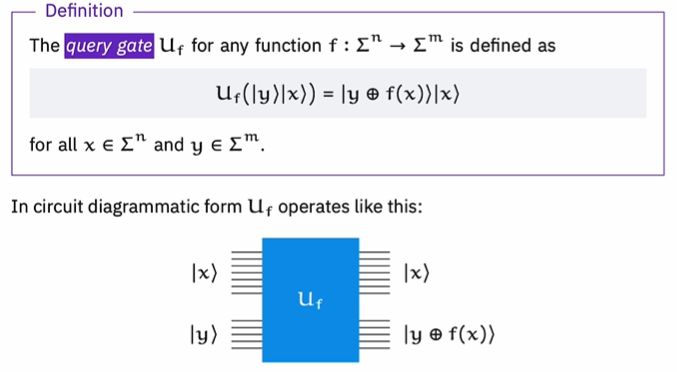
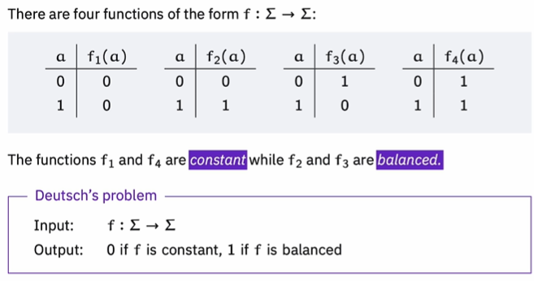
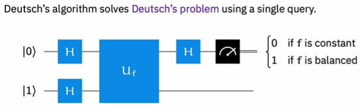
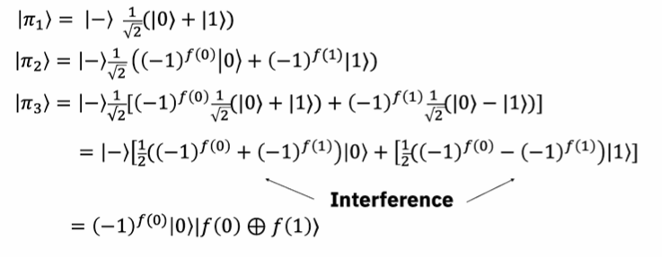
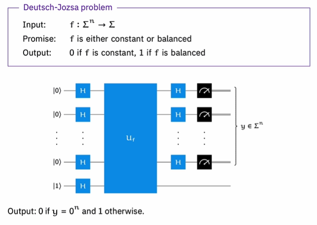

# QSKIT 2026

## Why Quantum? What Problem Are We Solving?

### Key Quantum Concepts

- **Superposition**: A quantum system existing in a complex linear combination of 2 states until it is measured
- **Entanglement**: Information shared jointly between entangled pairs or groups
- **Interference**: The combining of amplitudes so that possibilities can reinforce or cancel one another

### Query Gate (Oracle)

The query gate (oracle) takes n bits input and m bits output.

$$U_f|y\rangle|x\rangle = |y \oplus f(x)\rangle|x\rangle$$

- **Input**: 2 registers of input, read right to left
- **Diagram**:

note: quantum gates must be reversible

### A Misconception

It is possible to feed in a superposition of all possible x values at once via a Hadamard gate:

$$\frac{1}{\sqrt{2^n}} \sum_x |x\rangle$$

Since quantum operations are linear, applying the circuit to this superposition of x gives a superposition of all corresponding output pairs simultaneously (**quantum parallelism**).

**HOWEVER**, quantum states are not directly readable - you must **measure** to get any information out. This causes the superposition to **collapse**, giving one random term via a probability (amplitude squared), which is uniform here.

### Effect of Hadamard gate $H$:

$$H|0\rangle = \frac{1}{\sqrt{2}}(|0\rangle + |1\rangle) \equiv |+\rangle$$

$$H|1\rangle = \frac{1}{\sqrt{2}}(|0\rangle - |1\rangle) \equiv |-\rangle$$

### Phase kickback:

$$U_f|-\rangle|x\rangle = (-1)^{f(x)}|-\rangle|x\rangle$$

So $U_f|-\rangle|x\rangle = |-\rangle|x\rangle$ if $f(x) = 0$

and $U_f|-\rangle|x\rangle = -|-\rangle|x\rangle$ if $f(x) = 1$

### The Parity Problem/Deutsch's Problem

BQP: bounded-error quantum polynomial time
can be solved with high probability in polynomial time

### Deutsch-Jozsa problem

### Some more algorithms

Simon's algorithm
Shor's algorithm
Quantum phase estimation
Grover's search

https://quantumalgorithmzoo.org/

### Quantum applications

simulating nature
- spin models
- materials
- chemistry
- high energy physics

maths and data
- factoring
-abelian hidden subgroup
- supervised learning (classification)
- unsupervised learning (clustering)
- time series
- gregression
- lin alg

search and optimisation
- combinatorial optimisation
- black-box optimisation
- general mixed integer

https://www.nature.com/articles/s41586-023-06096-3

Hamiltonian simulation

Optiimzation

ML

Differential equations

Quantum error correction

Encoding logical qubits in error correcting codes allows one to detect and correct errors DURING circuit executino at the cost of an overhead in the number of qubits

Fault toleratnt quantum computing implements error correcting codes in such a way that both te error corerection and universal set of logical operatins can be carried out in a way that reduces errors.

